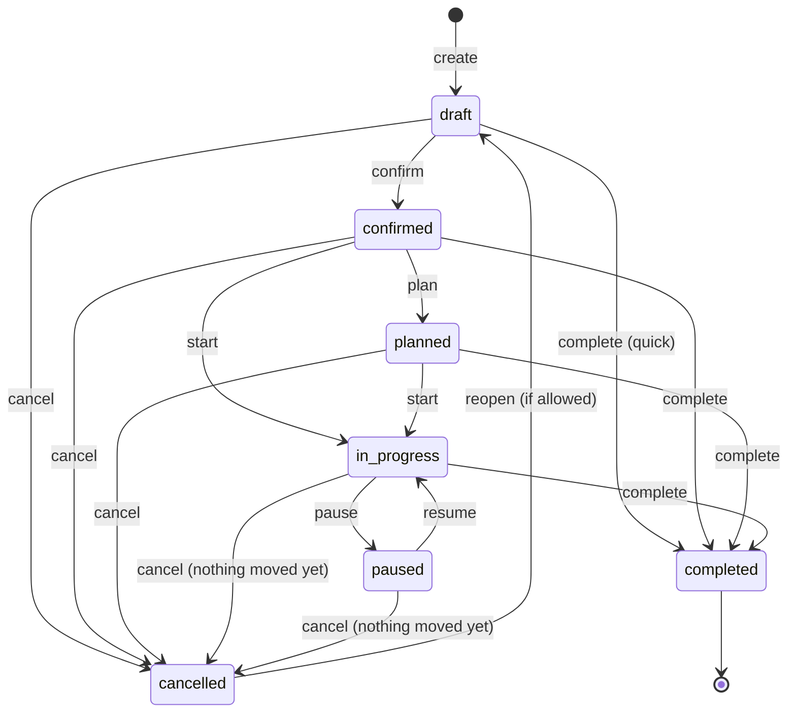
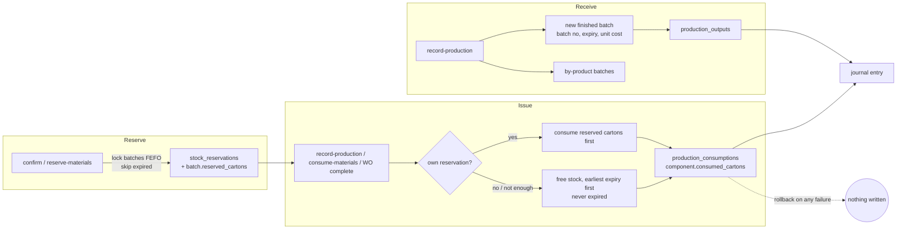
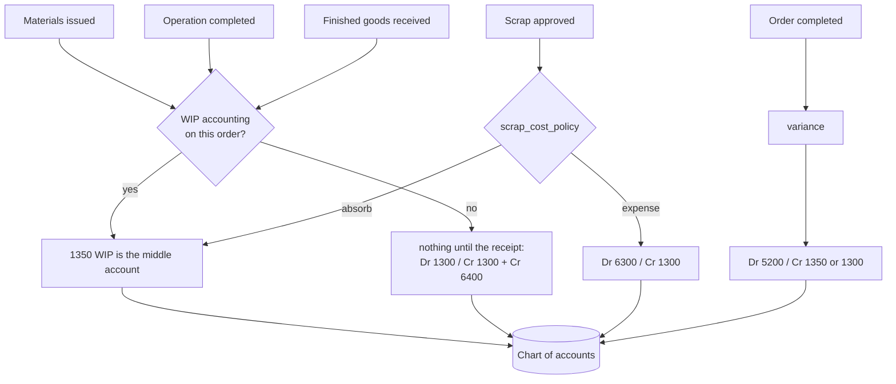
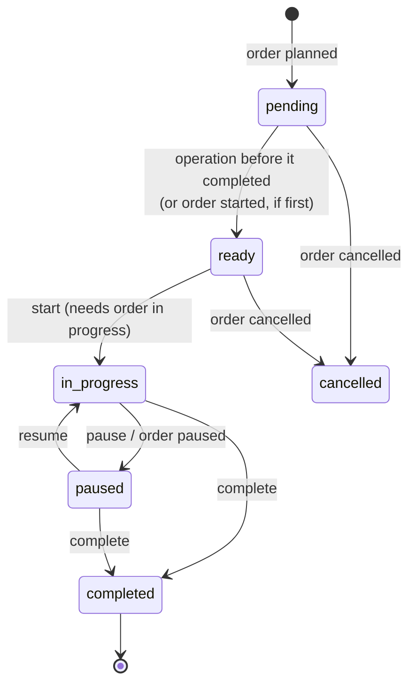

# Manufacturing — business workflows

## 1. Manufacturing order lifecycle

Status never changes because a client sends a new status. Every change is an *action* that asks the state machine
whether the move is allowed and does the work that goes with it, all in one transaction, with a line in the
order's append-only history. `PUT /production-orders/{id}` ignores `status`.

| Action | From | What it does |
|---|---|---|
| `create` | – | numbers the order (`MO00001`), works out the output from `qty_cartons` or `runs`, sets the default conversion cost. Needs an **approved, active** recipe |
| `confirm` | draft | snapshots the recipe's components (with scrap allowance), records the recipe **revision** used, estimates planned cost, raises quality checks, and — unless reservation is manual — reserves the materials. Fires *shortage* when something could not be reserved |
| `plan` | confirmed | creates the work orders from the routing and books them on their work centers (capacity-aware); sets planned start/finish |
| `reserve-materials` / `release-materials` | confirmed … paused | reserve what is still missing, as far as stock allows / give it back |
| `start` | confirmed, planned | in progress; makes the first operations ready |
| `pause` / `resume` | in progress / paused | pauses running operations (closing their time logs) |
| `record-production` | confirmed … in progress | receives finished goods (and by-products); issues the materials for them first when backflushing; auto-starts the order |
| `consume-materials` | confirmed … in progress | issues materials by hand (manual consumption, optional components, extra material) |
| `record-scrap` | confirmed … paused | wastes material or rejects output; may wait for approval |
| `complete` | draft … in progress | makes whatever is left (unless `produce_remaining: false`), requires work orders done and quality checks passed, writes off variance, releases reservations, handles the backorder |
| `cancel` | draft … paused | releases reservations, cancels open operations. **Refused** once stock has moved or an operation has run |
| `reopen` | cancelled | back to draft, only when `allow_reopen_cancelled` is on |
| `create-backorder` | completed | a new draft order for what was not made (once per order) |

**Reservation and quality are separate from status**: `reservation_status` is `none` / `partial` / `reserved`; quality checks are their own
records that block completion. A company can switch transitions off in `allowed_transitions` (never add one).

### Completing short

`complete` with `produce_remaining: false` and units still unmade needs a decision, set by `backorder_policy`:
`ask` (the request must say `create_backorder: true|false`), `always` (raise a backorder), `never` (close short). A backorder is a draft
order for the remainder, linked to its parent (`parent_order_id`, `source_type: backorder`) and carrying a proportional conversion cost.

### Quick completion (the original one-call flow)

`POST /production-orders/{id}/complete` on a draft order still does everything the old endpoint did — consume the
components, create the finished batch, post the cost — but now through the same engine: confirm without reserving, start, backflush, receive,
close. The result, the batch, the journal entry and the stored costs are the same as before.

## 2. Inventory movement flow

* **Source of truth.** Stock stays in `inventory_batches`. There is no stock-movement ledger in this ERP; the documents are the movement
  records: `production_consumptions` (issues and scrap, with batch and cost), `production_outputs` (receipts), `stock_reservations`.
  Each carries the order, the component line and (when relevant) the work order that caused it.
* **No oversubscription.** Reserved cartons are subtracted from what sales, transfers, write-offs and purchase returns may take. The
  running total is kept on the batch row and read under the same row lock every stock flow takes, so two requests can never both
  take the last carton. Expired batches are never reserved or issued.
* **Shortfall.** If the warehouse cannot cover an issue, the whole request fails with the same `shortfalls` body as sales and nothing is
  written — including stock already issued earlier in the same request.
* **Batches.** The first receipt of an order uses the order's batch number; later receipts add `-2`, `-3`…; by-products add `-BP1`…. A batch number
  that already exists in the warehouse is refused.
* **Retries.** Idempotency keys make receive / issue / scrap / complete safe to repeat (see costing-and-accounting.md).

## 3. Accounting integration flow

See costing-and-accounting.md for the entries, the valuation formula and the policies.

## 4. Work-order execution

* **Scheduling.** Operations are booked in routing order, each no earlier than the one it depends on ends. A work center's working time is its weekly
  shifts less company holidays (HR holidays) and declared downtime; an operation may run across shifts and days. If the center is already at
  its capacity then, the operation moves to the first moment a place frees up. The center row is locked and bookings are read with a locking
  read, so two concurrent plans cannot take the last place.
* **Dependencies.** An operation cannot start until the one it depends on is completed (422 otherwise).
* **Quantity.** An operation can process at most what the one before it passed on; rejected cartons are recorded on the operation, added
  to the order's rejected quantity and absorbed in cost. Finished goods can only be received for what the **last** operation processed.
* **Time and cost.** Each start/resume opens a time log, each pause/complete closes it; actual minutes are their sum. Completing costs the
  time at the work center's machine and labour rates, issues the materials tied to that operation, and (WIP orders) books the cost.
* **Quality.** Checks tied to the operation must pass before it completes; checks on the order must pass before the order completes.
* **Completing an operation never completes the order**: the order closes only through `complete`, which requires every operation done.
* **Rescheduling** moves an operation that has not started; it refuses a busy or non-working time unless `auto_shift` is set, and never
  before the operation it depends on ends. Declaring downtime lists the operations booked inside it so they can be moved.

## 5. Quality

Definitions say what to check, where (`incoming`, `in_process`, `final`), for which product/operation, and what passes (pass/fail or a measured
value within limits). Checks are raised from them when an order is confirmed or its work orders are created; incoming-material
inspections are raised by hand. A failed check opens an alert. A mandatory check blocks completion until its **latest** inspection passes — a failed
check is superseded by a later passing check of the same kind. There is no hook from Purchasing receipts into inspections: they are raised manually.

## 6. Purchasing and sales

* **Planning → purchasing.** Purchase suggestions become draft purchase orders through the normal purchasing service, one per supplier and warehouse,
  **without costs**, so each waits in `pending_pricing` for an administrator exactly like a buyer's order. Open purchase orders count as incoming supply.
  Receiving them is the existing receipt flow, which puts the stock in.
* **Sales → production.** Open sales orders (draft, picking) are demand for planning. `POST /production-orders/from-sales-order` raises
  draft orders (make-to-order) for the manufactured products an open sales order needs that free stock does not cover; they carry the sales order as source
  and are never duplicated. `GET /production-orders?source_type=sales_order&source_id=…` traces production back to the demand.
  If the sales order is cancelled, planning reports the orders (or cancels the unstarted ones, per setting); production in progress is never cancelled automatically.
