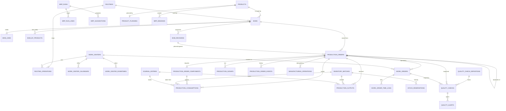

# Manufacturing — database design

Everything here is tenant-scoped (`tenant_id` on the root tables; child tables inherit it
through their parent). Primary keys are ULIDs. Quantities of stock are whole cartons
(`unsigned integer`); only *requirements* (`required_qty`) are decimals, rounded up to whole cartons when
stock is issued or ordered. Money is `decimal(14,2)`; unit costs `decimal(10,2)`.

Existing tables the module uses and does **not** duplicate: `products`, `units`, `product_units`,
`warehouses`, `inventory_batches`, `suppliers`, `purchase_orders` / `purchase_order_lines`,
`sales_orders` / `sales_order_lines`, `chart_of_accounts`, `journal_entries` / `journal_lines`,
`users`, `audit_log`, `notifications`, `hr_holidays`.

## Core relationships

## Tables

### Configuration

| Table | Purpose | Notable columns / rules |
|---|---|---|
| `manufacturing_settings` | one row per company, created with defaults on first read | document prefixes and padding; `default_warehouse_id`; `lead_time_days`; policies (`reservation_policy`, `consumption_policy`, `backorder_policy`, `scrap_cost_policy`); flags (`allow_partial_production`, `allow_over_consumption`, `scrap_requires_approval`, `require_bom_approval`, `auto_create_work_orders`, `allow_reopen_cancelled`, `cancel_unstarted_on_demand_cancel`); costing (`wip_accounting`, `overhead_rate_pct`, `by_product_cost_method`, `cost_decimals`); `mrp_horizon_days`; `allowed_transitions` (json) |
| `manufacturing_sequences` | gap-free document counters | unique `(tenant_id, key)`; row-locked while a number is issued, so a rolled-back document gives its number back |

### Recipes

| Table | Purpose | Notable columns / rules |
|---|---|---|
| `boms` | a recipe for one finished product | `code` (unique per company), `version`, `status` (draft/approved), `priority`, `effective_from/to`, `routing_id`, `active` + `archived_at`, `approved_by/at`, `output_qty_cartons`, `conversion_cost` (per run). Several per product are allowed |
| `bom_lines` | components | `qty_cartons` (per run), `scrap_pct`, `optional`, `unit_id` + `unit_qty` (when entered in a packaging unit), `operation_id`; unique `(bom_id, component_product_id)` |
| `bom_by_products` | secondary outputs | `qty_cartons` per run, `cost_share_pct`, `warehouse_id`; unique `(bom_id, product_id)` |
| `bom_revisions` | **immutable** json snapshots, one per version | unique `(bom_id, revision_no)`; the model refuses updates and deletes |

### Routing and work centers

| Table | Purpose |
|---|---|
| `work_centers` | `capacity` (parallel operations), `efficiency_pct`, `cost_per_hour` (machine), `labor_cost_per_hour`; unique `(tenant_id, code)` |
| `work_center_calendars` | weekly shifts (`weekday` 0 = Sunday … 6, `start_time`, `end_time`) |
| `work_center_downtimes` | unavailable periods; index `(work_center_id, starts_at, ends_at)` |
| `routings`, `routing_operations` | ordered steps: `sequence`, `work_center_id`, `setup_minutes`, `run_minutes` (per carton), `cleanup_minutes`, `depends_on_id` (an earlier step); unique `(routing_id, sequence)` |

### Orders

| Table | Purpose | Notable columns / rules |
|---|---|---|
| `production_orders` | the manufacturing order | `number` (unique per company), `status` (draft, confirmed, planned, in_progress, paused, completed, cancelled), `priority` 0–3, `reservation_status` (none/partial/reserved — separate from status), `output_qty_cartons` (planned) / `produced_qty_cartons` / `rejected_qty_cartons`, planned and actual dates, `assigned_to`, `bom_revision_id`, `parent_order_id` (backorder), `source_type` + `source_id`, `cancellation_reason`, cost fields (`planned_*`, `actual_*`, `scrap_cost`, `capitalized_cost`, `capitalized_material`, `variance_cost`), `wip_accounting` (fixed at confirmation). Legacy columns (`material_cost`, `cost_per_carton`, `conversion_cost`, `output_batch_id`, `journal_entry_id`) keep their meaning |
| `production_order_components` | the order's own copy of its requirements, fixed at confirmation | `required_qty` (decimal 4, exact), `required_cartons` (issued in whole cartons, rounded up), `reserved_cartons`, `consumed_cartons`, `optional`, `work_order_id`; unique `(production_order_id, product_id)` |
| `production_consumptions` | every issue of material | `kind` consume/scrap, `absorbed` (scrap carried by the product), batch and cost per carton, `component_id`, `work_order_id`, `journal_entry_id` |
| `production_outputs` | every receipt of finished goods or by-products | `kind`, batch created, `qty_cartons`, `rejected_cartons`, unit cost and value, `journal_entry_id` |
| `production_scraps` | scrap documents | `kind` component/finished, `status` (pending/approved/rejected), cost, ledger entry, who asked and who decided |
| `production_order_events` | **append-only** history | action, from/to status, user, json payload; the model refuses updates and deletes |
| `manufacturing_operations` | idempotency ledger | unique `(production_order_id, action, idempotency_key)`; stores the first outcome so a retry returns it |
| `work_orders`, `work_order_time_logs` | operations of an order and the time spent | status pending/ready/in_progress/paused/completed/cancelled; `depends_on_id`; `qty_planned/processed/rejected`; scheduled and actual times; `labor_cost`, `machine_cost`; index `(work_center_id, scheduled_start, scheduled_end)` serves the capacity check |

### Inventory (in the Inventory module)

| Table | Purpose |
|---|---|
| `stock_reservations` | cartons of one batch set aside for a document: `source_type` + `source_id` (+ `source_line_id`), `qty_cartons`, `status` active/consumed/released |
| `inventory_batches.reserved_cartons` | running total of a batch's active reservations, maintained **under the batch row lock** and read by every flow that takes stock (sales, transfers, write-offs, returns, production) |

### Quality

`quality_check_definitions` (what to check, where, limits, mandatory), `quality_checks` (one inspection, with a copy of the
definition's limits, result, measured value, defect class), `quality_alerts` (opened by a failed check).

### Attachments

`manufacturing_attachments`: `attachable_type` (bom, production_order, work_order, routing, quality_check) + `attachable_id`, `path`, `original_name`, `mime_type`, `size`, `description`, `uploaded_by`.
Index `(attachable_type, attachable_id)`. The file lives on the default disk under `manufacturing-attachments/{tenant}/`.

### Planning

| Table | Purpose | Notable columns / rules |
|---|---|---|
| `product_planning` | per-product planning policy | `procurement` (make/buy/auto), `lead_time_days`, `lot_rule` + `lot_qty/min_qty/max_qty/multiple_qty`, `make_to_order`; unique per product |
| `mrp_demands` | manual needs and forecasts | product, warehouse, cartons, due date, kind, status |
| `mrp_runs` | one planning run | `number`, `status` queued/running/completed/failed, `inputs`, `stats`, `error`, start/finish |
| `mrp_run_lines` | the requirements report | per product: level, gross requirement, on hand, reserved, incoming, safety stock, net requirement, planned quantity, action, `sources` |
| `mrp_suggestions` | proposed orders | `type` manufacture/purchase, quantities and dates, `fingerprint`, `open_key` (equal to the fingerprint while proposed or dismissed, null afterwards — unique `(tenant_id, open_key)` means **at most one open proposal per need**), `converted_type/id` |

## Deletion policy

* Deleting a BoM is refused (409) while orders use it; deleting a work center or routing is refused (409) while operations,
  routings or work orders use it — retire them with `active: false` / archive instead.
* `bom_revisions`, `production_order_events`: no update, no delete (except along with the BoM / order they belong to).
* Journal entries are never deleted; every table that points at one uses `restrictOnDelete`.
* `stock_reservations.batch_id` is `nullOnDelete`: a batch emptied to zero may be removed, and the invariant "reserved ≤ on hand"
  means a batch with an active reservation is never empty.

## Indexes worth knowing

| Index | Serves |
|---|---|
| `inventory_batches (product_id, warehouse_id, exp_date, rcv_date)` (existing) | FEFO for sales and production |
| `stock_reservations (batch_id, status)`, `(product_id, warehouse_id, status)`, `(source_type, source_id, status)` | reserve / release / consume |
| `work_orders (work_center_id, scheduled_start, scheduled_end)` | capacity check while scheduling |
| `production_orders (tenant_id, number)` unique, `(source_type, source_id)`, `planned_start`, `status` | lookups, MRP supply and demand |
| `mrp_suggestions (tenant_id, open_key)` unique | no duplicate proposals on re-runs |
| `manufacturing_operations` unique replay key | no duplicate processing on retries |
