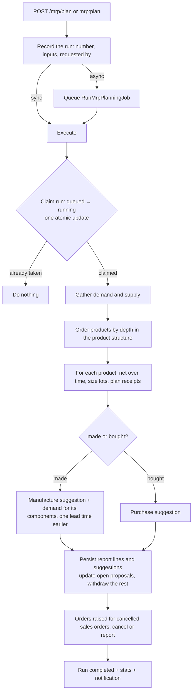

# Material requirements planning (MRP)

Planning answers "what do we need to make or buy, how much, and by when?" for **one warehouse** at a
time. It only *proposes*: nothing is ordered until a person converts a suggestion into a draft manufacturing order or a
purchase order.



## Inputs

| Input | Source |
|---|---|
| Warehouse | `warehouse_id`, else the default warehouse in the settings |
| Horizon | `horizon_days`, else `mrp_horizon_days` (30). Demand due later is left for a later run |
| Today | the day the run executes. Demand dated in the past is treated as due today |

## Demand

| Kind | Where from | Date | Quantity |
|---|---|---|---|
| Sales | lines of sales orders that are `draft` or `picking` and have not deducted stock, drawing on this warehouse (the line's own, else the order's); gift lines are ignored (they use free-gift stock) | the order date | cartons, worked out like the sales module does (a pack line rounds up to whole cartons) |
| Manual / forecast | `mrp_demands` that are `open` | its due date | its cartons |
| Open manufacturing orders | materials an order **still has to take from stock**: `required_cartons − consumed_cartons − reserved_cartons` for confirmed orders; computed from the recipe for draft orders | the order's planned start | cartons |
| Planned orders | the components of every manufacture suggestion made earlier in the same run | the suggestion's start date | **exact** (decimal) quantity |

What an order has already reserved is *not* counted as demand again, because reserved cartons are
already excluded from free stock — this is what prevents double counting.

## Supply

| Kind | Quantity | Date |
|---|---|---|
| Free stock | on hand, **not expired**, **not reserved**, not a free-gift batch | today |
| Open purchase orders | all non-received, non-cancelled orders to the warehouse (draft, sent, pending, pending pricing) | `expected_date`, else the order date |
| Open manufacturing orders | `output − produced − rejected` of orders that are draft, confirmed, planned, in progress or paused | planned finish, else planned start, else production date |

Counting draft orders and orders waiting to be priced is deliberate: a converted suggestion is exactly such a document, and it
must count as supply or the next run would propose it again.

## Order of calculation

1. Starting from every product with demand, **and** every product with a safety stock or reorder point, follow the recipes of
   the products that are made (approved, in date, best priority) and give every product a **level**: finished goods 0, their
   components 1, and so on (the longest path). Products are processed in level order, so all demand a product can receive
   from the suggestions of the products above it exists before it is planned.
2. For each product, with the lead time `L` and lot rule of its planning policy:

   ```text
   projected = free stock
   for each date in order (supply before demand on the same day):
       supply  → projected += quantity
       demand  → projected −= quantity
                 if projected < safety stock:
                     shortage = safety stock − projected
                     for each lot in LotSizer(shortage):      # may be several if the rule splits it
                         plan a receipt of `lot` due on this date;  projected += lot
   after the last date:
       afterPlan = projected   (including planned receipts)
       target    = safety stock
       if reorder point > 0 and afterPlan < reorder point: target = max(safety stock, reorder point)
       if afterPlan < target: plan one more receipt (lots) of target − afterPlan, due today
   ```

3. Every planned receipt becomes a suggestion:
   * **made** (it has an approved recipe and the policy does not say "buy"): a *manufacture* suggestion with
     `start = due − L` (lead time of the policy, else the settings' `lead_time_days`) — if that is already past, the start is
     today and the suggestion is marked `late`. The recipe is exploded into demand for its components on the start date:
     `component quantity × (suggested ÷ recipe output) × (1 + scrap %)`, exact, not rounded.
   * **bought**: a *purchase* suggestion with `start = due − L`, for the product's supplier.
4. The product is written to the run's report with its gross requirement, stock, reserved, incoming, safety stock, net
   requirement, planned quantity, due date, action and the sources of the demand.

### Lot sizing

| Rule | Behaviour |
|---|---|
| `exact` (default) | the shortage, rounded up to a whole carton |
| `fixed` | whole multiples of `lot_qty` |
| `multiple` | rounded up to a multiple of `multiple_qty` |
| `min_max` | at least `min_qty`; no single order above `max_qty` — a bigger need is split (e.g. min 20, max 50, need 120 → 50, 50, 20) |

All results are whole cartons: stock is held in whole cartons, so the exact decimal requirement is rounded up here, once,
at the point of ordering — not at every level of the explosion.

### Safety stock and reorder point

They are the product's existing `min_stock_cartons` (safety stock) and `reorder_level` (reorder point). They are *per product*, not
per warehouse, so run planning for the warehouse you replenish. A `make_to_order` product ignores both: it is made only
against demand.

### Units and scrap

Quantities in a packaging unit are converted to whole cartons when they are entered (recipes, purchase orders); sales lines
are converted by the sales module's rule. Scrap allowances multiply the component quantity. Both are therefore already
in cartons by the time planning sees them.

## Safe re-runs

* Each suggestion has a **fingerprint** = type + product + warehouse + due date (+ a chunk number when a lot rule splits an order) and
  an `open_key` equal to it while the suggestion is open (proposed or dismissed). `unique(tenant_id, open_key)` makes it
  impossible to hold two open proposals for the same need.
* A run *updates* the open proposal of a need it finds again (quantity, start date, supplier, sources) instead of adding another.
* Open proposals a run no longer asks for are **superseded** (withdrawn). A **dismissed** suggestion stays dismissed while the same need
  remains.
* A suggestion that was **converted** stops being open; the document it became counts as supply, so it is not proposed again.
* A run is claimed with one atomic status change (`queued → running`). A job that is delivered twice, or retried, finds the run
  already taken and does nothing. A run that fails is marked `failed` with a safe message (the details go to the log) and
  everything it had written is rolled back; the next run starts clean.
* Only one run per warehouse can be waiting or running.

## Demand that goes away

When a sales order is cancelled, its demand simply disappears from the next run, which withdraws the proposals that existed
only for it. Manufacturing orders already **raised** for it are found by their source (`source_type = sales_order`):
with `cancel_unstarted_on_demand_cancel` on, those still in draft, confirmed or planned with no stock moved are cancelled;
otherwise, and for anything under way, they are only reported (`orphaned_orders` in the run's statistics). Production in progress
is never cancelled automatically.

## Performance

The inputs are read with aggregating queries (one per demand kind, one per supply kind), stock is read once per product, and the recipe lookup is
once per product. A test plans 80 products and asserts a bound on the number of queries per product. Large companies should run planning on
the queue (`async: true`, or the nightly `mrp:plan` command) rather than in a request.

## What it does not do

* **Reschedule existing supply.** If a purchase order arrives after the demand it would cover, planning proposes a new order for that date and shows the late
  supply in the sources — it does not suggest moving the order in.
* **Forecast.** There is no forecasting engine; a forecast is a manual demand with `kind: forecast`.
* **Multiple warehouses in one run**, and per-warehouse safety stock.
* **Supplier lead times and prices.** Lead time is the product's; the supplier is the product's `supplier_id`.
